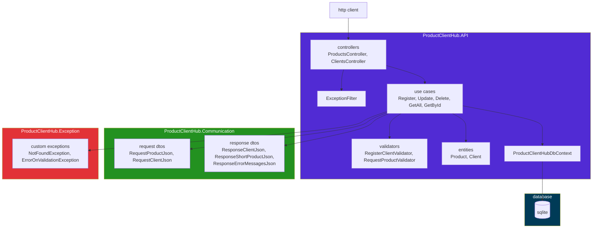

<div align="center">

<pre>
 ┌────────────────────────────────────────────────────┐
 │  user@dev:~/projects$ ./productclienthub           │
 │                                                    │
 │               █████╗   ██████╗   ██╗               │
 │              ██╔══██╗  ██╔══██╗  ██║               │
 │              ███████║  ██████╔╝  ██║               │
 │              ██╔══██║  ██╔═══╝   ██║               │
 │              ██║  ██║  ██║       ██║               │
 │              ╚═╝  ╚═╝  ╚═╝       ╚═╝               │
 │                                                    │
 │  > clients and products · asp.net core + sqlite    │
 └────────────────────────────────────────────────────┘
</pre>


</div>

---

## `$ cat about.txt`

```
productclienthub is a rest api that registers clients and the products
each one owns, stored in sqlite.

every endpoint is a thin controller that creates one use case and calls
Execute(). the use case validates the body with FluentValidation, reads
and writes through entity framework core and throws a typed exception
when something is off. a single ExceptionFilter turns that exception
into the http status and an {"errors": [...]} body, so no controller
has a try/catch.

built as a hands-on study of c# and asp.net core, split into three
projects: the api, the request/response contracts and the exceptions.
```

## `$ ls features/`

```
[x] clients: register, list, get by id (with its products), update, delete
[x] products: register under a client, delete
[x] FluentValidation on every body — all messages come back in one response
[x] typed exceptions mapped to 400 / 404 / 500 by one ExceptionFilter
[x] deleting a client deletes its products (ON DELETE CASCADE)
[x] swagger ui at /swagger in development
[ ] products have no get or update — only register and delete
[ ] no migrations — a fresh clone has no tables until you create them
[ ] sqlite path is hardcoded to a folder on the author's machine
[ ] no auth, no tests
```

## `$ cat stack.lock`

```
runtime     .net 10 (net10.0), c#
framework   asp.net core web api, controllers
database    sqlite via entity framework core 10.0.2
validation  FluentValidation 12.1.1
docs        swagger ui (Swashbuckle.AspNetCore 10.1.2), development only
infra       none, runs locally
tests       none yet
tooling     dotnet cli / visual studio
```

## `$ cat architecture.mmd`



## `$ ./install.sh`

```bash
# clone
git clone https://github.com/miguelcrwz/productclienthub.git
cd productclienthub

# dependencies (needs the .net 10 sdk)
dotnet restore

# database — there are no migrations yet, so create the two tables once
# (sqlite3 cli, or paste the sql into db browser for sqlite)
sqlite3 ProductClientHubDB.db "
CREATE TABLE Clients  (Id TEXT PRIMARY KEY, Name TEXT NOT NULL, Email TEXT NOT NULL);
CREATE TABLE Products (Id TEXT PRIMARY KEY, Name TEXT NOT NULL, Brand TEXT NOT NULL,
                       Price REAL NOT NULL,
                       ClientId TEXT NOT NULL REFERENCES Clients(Id) ON DELETE CASCADE);"

# then point Data Source at the absolute path of that file — it is hardcoded in
#   ProductClientHub.API/Infrastructure/ProductClientHubDbContext.cs
```

## `$ ./run`

```bash
# development — swagger at http://localhost:5065/swagger
dotnet run --project ProductClientHub.API

# production (no swagger)
dotnet publish ProductClientHub.API -c Release -o out
dotnet out/ProductClientHub.API.dll --urls http://localhost:5065
```

```
info: Microsoft.Hosting.Lifetime[14]
      Now listening on: http://localhost:5065
info: Microsoft.Hosting.Lifetime[0]
      Application started. Press Ctrl+C to shut down.
```

## `$ ./productclienthub --routes`

```
method  path                      auth    description
──────  ────────────────────────  ──────  ──────────────────────────────────
POST    /api/clients              public  register a client
GET     /api/clients              public  list every client (id + name)
GET     /api/clients/{id}         public  one client with its products
PUT     /api/clients/{id}         public  replace a client's name and email
DELETE  /api/clients/{id}         public  delete a client and its products
POST    /api/products/{clientId}  public  register a product for that client
DELETE  /api/products/{id}        public  delete a product
```

```
200  GET found what it asked for
201  client or product created — body is {"id", "name"}
204  PUT / DELETE succeeded, or GET /api/clients with no clients yet
400  validation failed — every message in errors[]
     (malformed json or a non-guid id gets asp.net's default problem details)
404  the client or product id does not exist
500  anything unexpected — {"errors": ["Unknown error."]}
```

## `$ describe Clients Products`

```
Clients
Id          Guid      generated by the api (Guid.NewGuid())
Name        string    required
Email       string    required, must be an email (FluentValidation EmailAddress)

Products
Id          Guid      generated by the api (Guid.NewGuid())
Name        string    required, max 100 chars
Brand       string    required, max 50 chars
Price       decimal   greater than 0
ClientId    Guid      taken from the route, must be an existing client
```

## `$ curl -i`

```bash
# register a client
curl -i -X POST http://localhost:5065/api/clients \
  -H "Content-Type: application/json" \
  -d '{"name":"miguel","email":"miguel@email.com"}'
```

```
HTTP/1.1 201 Created
{"id":"423bc76e-a637-4f73-b7c0-85c4fca3150f","name":"miguel"}
```

```bash
# register a product for that client
curl -i -X POST http://localhost:5065/api/products/423bc76e-a637-4f73-b7c0-85c4fca3150f \
  -H "Content-Type: application/json" \
  -d '{"name":"notebook","brand":"dell","price":4599.90}'
```

```
HTTP/1.1 201 Created
{"id":"55a54c18-b993-45ec-af13-62037957cb7e","name":"notebook"}
```

```bash
# read the client back, products included
curl -i http://localhost:5065/api/clients/423bc76e-a637-4f73-b7c0-85c4fca3150f
```

```
HTTP/1.1 200 OK
{
  "id": "423bc76e-a637-4f73-b7c0-85c4fca3150f",
  "name": "miguel",
  "email": "miguel@email.com",
  "products": [{ "id": "55a54c18-b993-45ec-af13-62037957cb7e", "name": "notebook" }]
}
```

```bash
# empty body — every validation message comes back at once
curl -i -X POST http://localhost:5065/api/clients \
  -H "Content-Type: application/json" \
  -d '{}'
```

```
HTTP/1.1 400 Bad Request
{"errors":["Client name is required.","A valid email address is required."]}
```

## `$ cat request.flow`

```
request
  │
  ├─ controller ─> new XxxUseCase().Execute()
  │    ├─ validator fails ─────────> throw ErrorOnValidationException
  │    ├─ id not in the database ──> throw NotFoundException
  │    └─ ok ─> SaveChanges() ────────────────────────────────> 200 / 201 / 204
  │
  └─ ExceptionFilter catches the throw
       ├─ ProductClientHubException ─> GetHttpStatusCode() ───> 400 / 404 + errors[]
       └─ anything else ──────────────────────────────────────> 500 "Unknown error."
```

## `$ tree`

```
productclienthub/
├── ProductClientHub.API/
│   ├── Controllers/        # ClientsController, ProductsController — http only
│   ├── UseCases/           # one folder per action + SharedValidator per resource
│   ├── Entities/           # Client, Product, EntityBase (Guid Id)
│   ├── Filters/            # ExceptionFilter — exception -> status + errors[]
│   ├── Infrastructure/     # ProductClientHubDbContext, where the sqlite path lives
│   └── Program.cs          # controllers, swagger, ExceptionFilter registration
├── ProductClientHub.Communication/
│   ├── Requests/           # RequestClientJson, RequestProductJson
│   └── Responses/          # response and error dtos
├── ProductClientHub.Exception/
│   └── ExceptionsBase/     # ProductClientHubException and its subclasses
├── ProductClientHub.slnx
├── LICENSE
└── README.md
```

## `$ git log --oneline roadmap`

```
a1b2c3d  move the connection string to appsettings.json
e4f5g6h  add ef core migrations so a fresh clone creates its own tables
i7j8k9l  inject ProductClientHubDbContext instead of creating it in every use case
m0n1o2p  get and update endpoints for products
q3r4s5t  integration tests with xunit and WebApplicationFactory
```

## `$ cat LICENSE | head -1`

```
MIT © 2026 Miguel Cruz
```

## `$ whoami`

```
miguel cruz
├── github    https://github.com/miguelcrwz
├── linkedin  https://linkedin.com/in/miguelcrwz
└── email     miguwlcrwz@gmail.com
```

<div align="center">

<pre>
$ exit
[process exited with code 0]
</pre>

</div>
